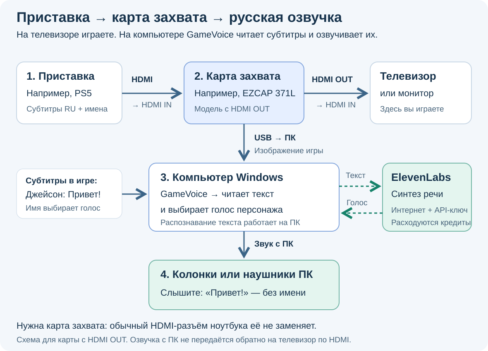

# GameVoiceGTA6

### Русские субтитры становятся голосами персонажей

Играете на приставке, а GameVoice читает русские субтитры с изображения и
произносит реплики вслух. За каждым персонажем можно закрепить свой голос.
Русская озвучка звучит из колонок или наушников, подключённых к компьютеру.

> **Бета · проект активно дорабатывается.** Сейчас запуск требует ручной настройки.
> Простой установщик и удобный первый запуск появятся в будущем.
> Возможны ошибки чтения, пропуски и задержки озвучки.

[Что понадобится](#что-понадобится) · [Как подключить](#как-подключить) ·
[Как запустить](#как-запустить) · [Сообщить об ошибке](https://github.com/Kiosok/GameVoiceGTA6/issues/new/choose)

## Как это работает

**Русские субтитры → распознавание текста на ПК → голос ElevenLabs → ваши колонки.**

Имя в субтитре помогает выбрать голос персонажа, но вслух не произносится.
Субтитры уже должны быть на русском: основной режим озвучивает готовый текст.

## Что понадобится

| Что | Для чего |
| --- | --- |
| Приставка с HDMI и игра с русскими субтитрами | Источник изображения. Рабочая связка проекта — PS5. |
| **HDMI-карта видеозахвата** | Передаёт изображение игры на компьютер по USB. Обычный HDMI-порт ноутбука обычно служит выходом и её не заменяет. |
| Компьютер с Windows 10/11 | Запускает GameVoice и распознаёт субтитры. Для текущих зависимостей нужна 64-битная Windows. |
| Телевизор/монитор и кабели | Для схемы выше нужны HDMI IN и HDMI OUT у карты, два HDMI-кабеля и USB-подключение к ПК. |
| Интернет и свой API-ключ ElevenLabs | Синтез речи выполняется в облаке и расходует кредиты вашего аккаунта. |
| Колонки или наушники, подключённые к ПК | Через них звучит русская озвучка. Микрофон не нужен. |

**По бюджету карты можно ориентироваться примерно на 1 000 ₽ за простую HDMI → USB
модель.** Это ориентир, а не гарантированная цена: [бюджетные предложения](https://www.ozon.ru/category/karta-videozahvata-hdmi/)
меняются. HDMI OUT есть не у всех карт; вариант с выходом на телевизор может стоить дороже.

В проекте используется **[EZCAP 371L](https://www.ezcap.com/ezcap371l)** с HDMI OUT.
**Совместимость других карт пока не подтверждена:** текущий код ожидает устройство
`USB3.0 Video` и захват MJPEG 1280×720, 30 кадров/с. Универсальный выбор карты в
интерфейсе ещё готовится. Перед покупкой другой модели учитывайте необходимость
ручной настройки. Надпись «4K» на коробке сама по себе не подтверждает совместимость.

## Как подключить

1. **Приставка → карта.** Подключите HDMI-выход приставки к **HDMI IN** карты захвата.
2. **Карта → телевизор.** Подключите **HDMI OUT** карты к телевизору или монитору.
   Выберите этот HDMI-вход на телевизоре — здесь вы продолжаете играть.
3. **Карта → компьютер.** Подключите карту USB-кабелем к ПК. Для EZCAP 371L используйте USB 3.0.
4. **Звук → колонки ПК.** В GameVoice выберите колонки или наушники в поле «Вывод звука».
   Русская озвучка приходит с ПК; по HDMI обратно на телевизор программа её не передаёт.
5. **В игре включите русские субтитры, имена персонажей и фон под текстом.**
   Начните со среднего размера. В программе выберите соответствующий размер субтитров;
   зелёная рамка должна охватывать все строки, включая третью, если она появляется.

Для захвата игрового процесса на PS5 может потребоваться выключить HDCP:
**Настройки → Система → HDMI → Включить HDCP → выкл.**
Использование внешних карт описано в [официальном FAQ PlayStation](https://blog.playstation.com/2020/11/09/ps5-the-ultimate-faq/).

У карты без HDMI OUT схема будет другой: для отдельного телевизора понадобится
дополнительное разветвление HDMI. Приведённая схема рассчитана на карту со сквозным выходом.

## Как запустить

**Готового публичного установщика пока нет.** В репозитории опубликован исходный код;
кнопка GitHub «Download ZIP» скачивает проект, который ещё нужно настроить.

Для тех, кто готов попробовать бету:

1. Подключите оборудование по схеме выше.
2. Выполните [пошаговую инструкцию запуска на Windows](docs/getting-started.md).
3. Сохраните свой ключ ElevenLabs, выберите голос и устройство вывода.
4. Включите «Озвучивать субтитры» и продолжите сцену с диалогом.

Будущий сценарий установки: **установить приложение → ввести свой ключ → выбрать
оборудование и голоса → играть.** Сейчас это план, а не готовый мастер настройки.

## Что уже умеет бета

- Читать русские субтитры и выбирать голос по имени персонажа.
- Закреплять голоса за персонажами через окно «Голоса персонажей…».
- Переключать режимы синтеза: быстрый Flash, сбалансированный v4 Turbo и качественный v4.
- Договаривать начатые фразы и обрабатывать очередь реплик.
- Сохранять отдельные области чтения для маленьких, средних и больших субтитров.
- Показывать состояние сервиса цветом: **зелёный — успешно, жёлтый — ожидание/повтор,
  красный — ошибка**, включая проблемы сети и ограничения региона.
- Озвучивать ТВ отдельным режимом. Радиоперевод — дополнительная функция со своим API.

Задержка зависит от читаемости текста, длины фразы, модели и интернета. Озвучка без
задержки и точность каждого распознанного слова пока не гарантируются.

## А голоса персонажей уже внутри?

**Голосовые записи и собранные клоны в репозиторий не включены.** После установки
можно назначить доступные голоса своего аккаунта ElevenLabs. Подготовлен скрипт
[импорта отдельного пакета образцов](docs/voice-packs.md), который создаёт голоса в
аккаунте получателя и связывает их с персонажами. Это пока инструмент для разработки.
Для клонирования нужны соответствующий тариф, свободные слоты и права на образцы.

## Если что-то не работает

| Симптом | Что проверить в первую очередь |
| --- | --- |
| Нет изображения | HDMI IN/OUT, USB-подключение, HDCP и совместимость карты. Закройте OBS и другие программы, использующие карту. |
| Не читает субтитры | Русский язык OCR Windows, фон под текстом, выбранный размер и зелёную область чтения. |
| Текст появился, а голоса нет | Галочку озвучки, «Вывод звука», цвет статуса, доступ ключа к TTS и остаток кредитов. |
| Слышны русский и английский одновременно | Проверьте звук телевизора и мониторинг карты в других программах: они могут отдельно воспроизводить оригинальную речь. |

Не получилось разобраться? [Создайте сообщение об ошибке](https://github.com/Kiosok/GameVoiceGTA6/issues/new/choose):
что произошло, какая карта и какой режим выбраны. **API-ключи в сообщения и скриншоты не добавляйте.**

## Что дальше

В приоритете — простой установщик, выбор оборудования, настройка голосов и устойчивое
чтение субтитров. Также исследуются более выразительная речь, произношение имён и
эффекты для телевизора. Подробнее: [план развития](docs/roadmap.md).

Для разработчиков: [запуск, тесты и сборка](docs/getting-started.md) ·
[пакеты голосов](docs/voice-packs.md) · [эксперимент эмоций](docs/emotions.md).

GameVoiceGTA6 — независимый неофициальный проект. Не связан с Rockstar Games или
ElevenLabs. Название проекта не означает наличие готовой полной русской озвучки игры.
